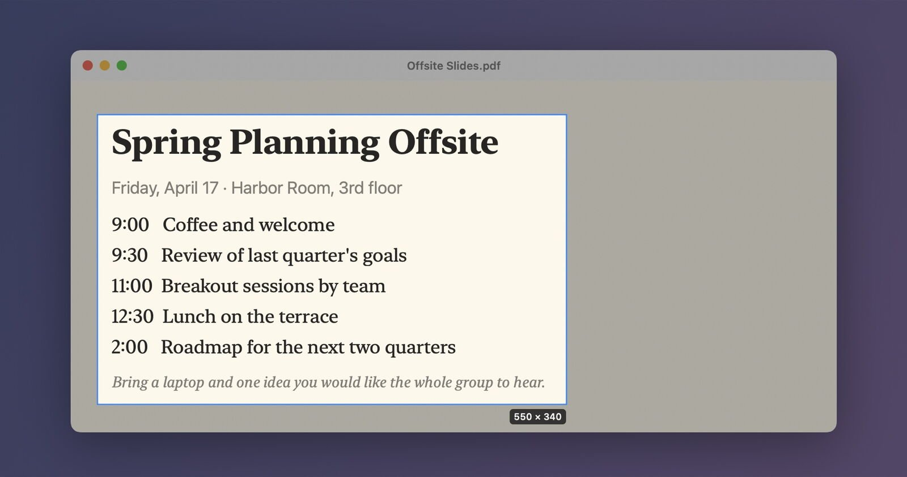
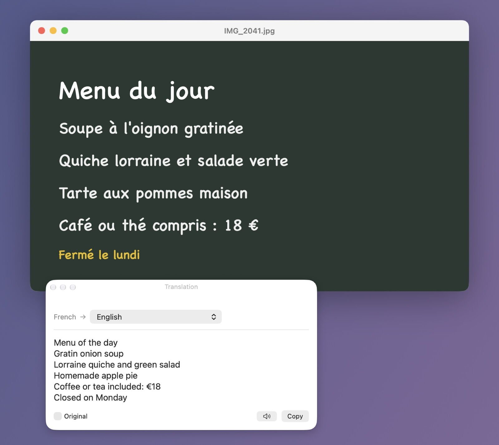
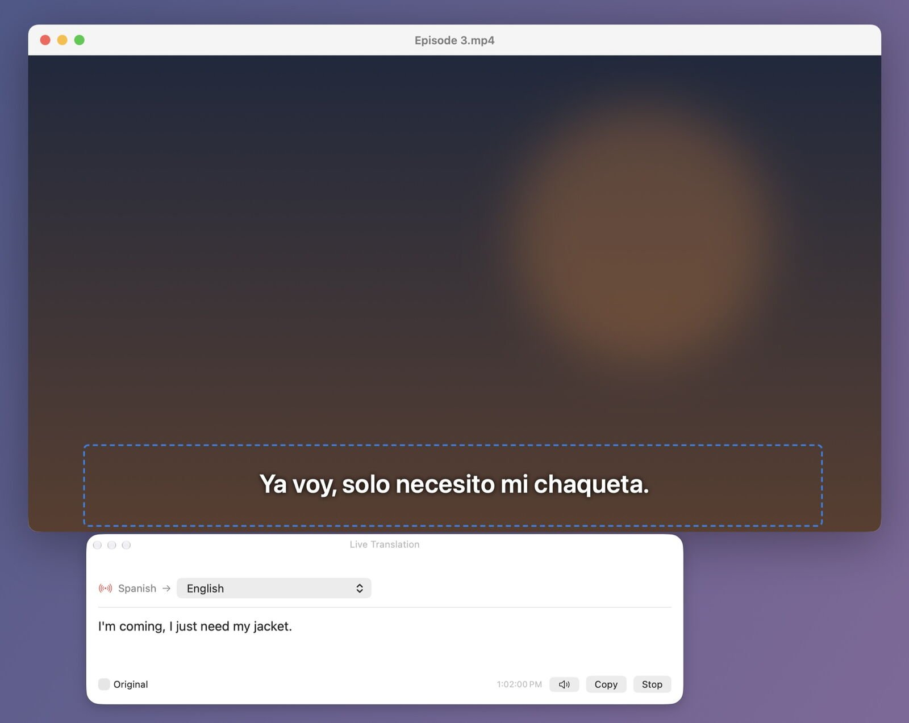
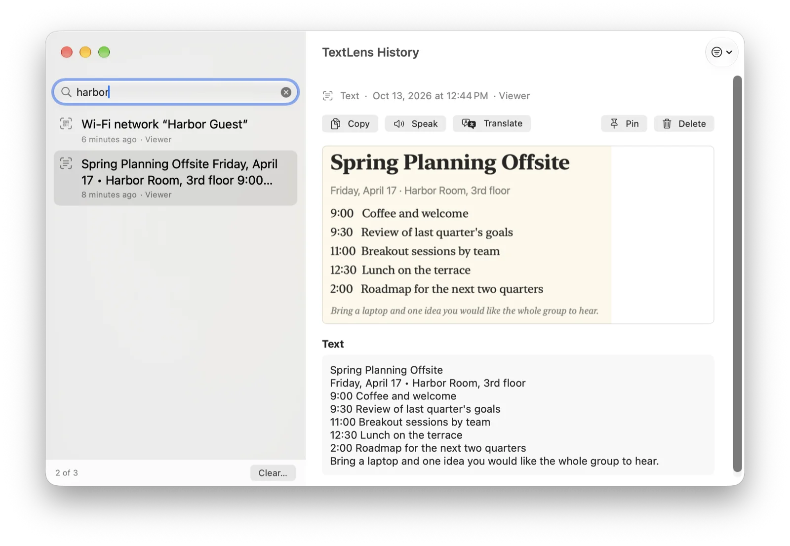
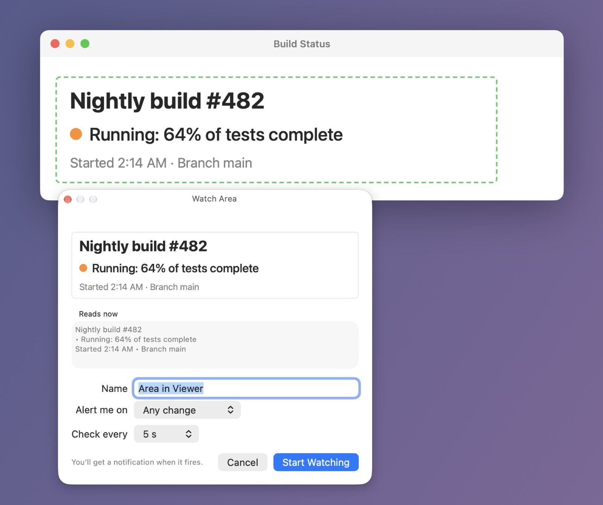
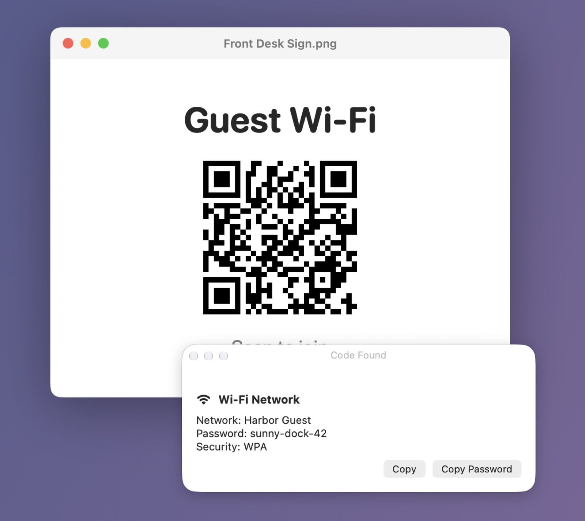
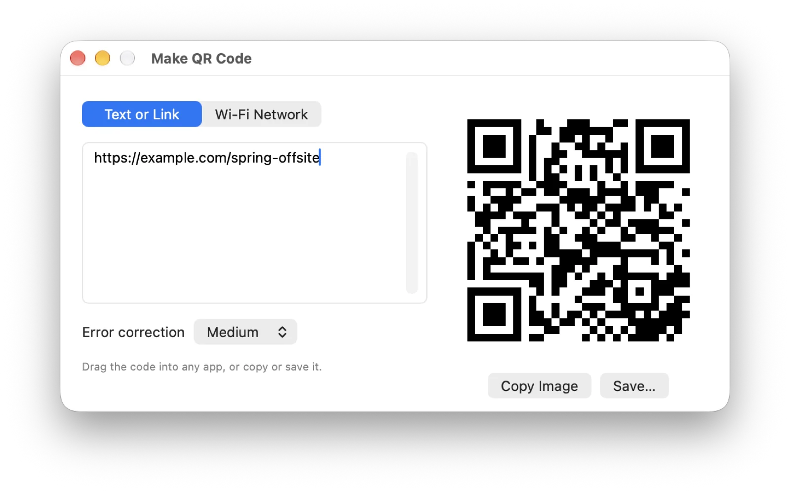

# TextLens

Copy any text you can see on your Mac, even text you can't select: text in pictures, videos, screen shares,
PDFs, apps and games. Drag over it and the text is on your clipboard. Everything runs on your Mac with
Apple's own text recognition and translation, and nothing is uploaded.

TextLens also:
- **Translates** what you capture, or keeps translating an area live (subtitles, chats, slides).
- **Remembers** every capture in a searchable history that can follow you to your other Macs, and graphs how much you capture over time.
- **Watches** an area of the screen and tells you when its text changes, or when a word shows up or goes away.
- **Reads and makes QR codes**: open links, join Wi-Fi, add contacts, or make a code for a link or your Wi-Fi.

<p align="center"></p>

## Download

**[⬇ Download TextLens.dmg](https://github.com/smanke-org/TextLens/releases/latest/download/TextLens.dmg)**

1. Open the disk image and drag **TextLens** to **Applications**.
2. Open TextLens. Its icon appears in the menu bar.
3. Allow **Screen Recording** when asked (System Settings › Privacy & Security › Screen & System Audio Recording). TextLens needs it to read the screen.

Requires macOS 26 or later.

## Features

- **Capture text**: press a shortcut, drag over the text, and it's copied when you let go. The screen freezes while you select, so a menu, tooltip or video frame stays put.
- **Capture again**: read the same area again without dragging, handy for something that keeps changing.
- **Files and copied pictures**: read the text in image and PDF files, or in a picture you've copied.
- **Capture options**: keep lines as they appear or join them into paragraphs, add each capture below what's already copied, read text aloud after capture, and add names and jargon that recognition should prefer.
- **Translate**: drag over text in another language and the translation appears in a panel next to it, using Apple's translation on your Mac.
- **Live translate**: TextLens keeps reading an area, such as subtitles or a chat, and translates whenever its text changes.
- **Watch an area**: get an alert when the text changes, or when a word shows up or goes away. Useful for a build status, a queue position or a price.
- **QR and bar codes**: read a code to copy it, open a link, join Wi-Fi or add a contact, and make QR codes for a link or your Wi-Fi.
- **History**: past captures and translations, with the picture of each. Search the text, pin what you want to keep, and sync it to your other Macs end-to-end encrypted.
- **Activity**: Settings › Activity graphs how many captures you've made, on this Mac or across all your Macs.
- **Shortcuts and URLs**: change any shortcut in Settings › Shortcuts, or run actions from `textlens://` URLs.
- **Private**: text recognition, translation and QR codes run entirely on your Mac, with no account, analytics or tracking.

## Screenshots

<table>
<tr>
<td width="50%"><br><sub><b>Translate.</b> A capture translated into your language.</sub></td>
<td width="50%"><br><sub><b>Live translate.</b> Subtitles translated as they change.</sub></td>
</tr>
<tr>
<td width="50%"><br><sub><b>History.</b> Search every capture, with its picture.</sub></td>
<td width="50%"><br><sub><b>Watch an area.</b> An alert when the text changes.</sub></td>
</tr>
<tr>
<td width="50%"><br><sub><b>Read QR codes.</b> Join Wi-Fi, open links or add contacts.</sub></td>
<td width="50%"><br><sub><b>Make QR codes.</b> For a link or your Wi-Fi.</sub></td>
</tr>
</table>

## Use it

| Shortcut | What it does |
|---|---|
| ⌃⌥⌘T | Capture text |
| ⌃⌥⌘R | Capture the same area again |
| ⌃⌥⌘D | Read a QR or bar code |
| ⌃⌥⌘Y | Capture and translate |
| ⌃⌥⌘U | Live translate an area (press again to stop) |
| ⌃⌥⌘W | Watch an area for changes |
| ⌃⌥⌘H | Show history |

All shortcuts can be changed in Settings › Shortcuts, and ShortcutsLens lists them. From the menu you can also read text in image and PDF
files, read a copied picture, and make QR codes.

Every shortcut's action can also be run from a URL, for ToolHUD, Shortcuts or scripts: `textlens://capture`,
`recapture`, `qr`, `translate`, `live-translate`, `watch` and `history` (for example `open textlens://capture`).

Settings › Activity graphs how many captures you've made. With "Sync settings with your other Macs" turned
on, it adds up the captures from every Mac that uses TextLens. Only the counts are shared through iCloud
Drive, never what you captured.

## Privacy

Text recognition, translation and QR codes run entirely on your Mac. TextLens has no account, analytics or
tracking, and nothing is ever sent to the developer. The only connection it makes on its own is to GitHub, to
check for updates.

Sync is end-to-end encrypted. With "Sync settings with your other Macs" on, your settings, capture history
(with its pictures) and capture counts are sealed with AES-256-GCM on your Mac before they reach iCloud,
using a key that only your sync passphrase unlocks. The passphrase never leaves your Macs, so neither Apple nor
the developer can read what's synced. History sync can be turned off on its own in Settings › History, and
Settings › Privacy explains all of this in the app.

## Updates

TextLens checks for new versions once a day, or as often as you choose in Settings (a number of hours, days, weeks or months). In Settings › General you choose whether it installs them
automatically when you're not using it, asks first, or doesn't check.
The update window shows the notes for the latest releases, with the ones you don't have yet marked New. After
an update that installed itself, Settings shows what changed the next time it opens.

## Build from source

The Xcode project is generated from `project.yml` with [XcodeGen](https://github.com/yonaskolb/XcodeGen).
Sync uses CloudKit, so builds are signed with a provisioning profile (Xcode signed in to the developer account).

```bash
xcodegen generate   # TextLens.xcodeproj: Debug, Release (GitHub) and AppStore (sandboxed) builds
./build_app.sh      # universal, Developer ID–signed .build/app/TextLens.app
./install.sh        # copy to /Applications and launch
swift test          # layout, QR, change-detection, history and encryption tests
```

Release: `./release.sh X.Y.Z` (notarizes, makes the DMG, tags and publishes the GitHub release).

## License

© 2026 Steve Manke. All rights reserved.
